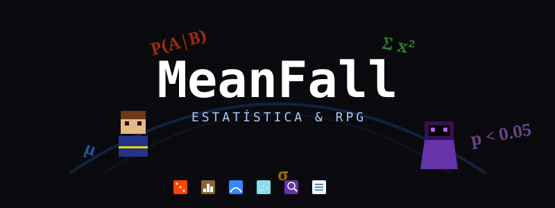

# MeanFall



> **An educational statistics RPG. Play it at [meanfall.pro](https://www.meanfall.pro)**

A top-down RPG that teaches statistics through tile-based exploration, turn-based combat and a complete elemental system. The player answers statistics questions to deal damage, collects elemental loot, completes quests and progresses through six themed regions, each tied to a different statistics topic.

Built with vanilla JavaScript and Phaser 3. A single-page application with no build step, no bundler and no dependencies other than the Phaser CDN.

> The in-game content (questions, dialogue and lore) is in Brazilian Portuguese.

---

## 🎮 Play Now

**[www.meanfall.pro](https://www.meanfall.pro)**

---

## World Regions

| Region | Topic | Element | Suggested Level |
|---|---|---|---|
| Data Village (Vila dos Dados) | Data types (categorical, ordinal, continuous) | Normal | 1 |
| Measures Meadows (Pradarias das Medidas) | Mean, median, mode | Earth | 3 |
| Dispersion Forest (Floresta da Dispersão) | Variance, standard deviation, IQR | Ice | 5 |
| Probability Plains (Planícies da Probabilidade) | Basic and conditional probability | Fire | 8 |
| Distribution Mountains (Montanhas das Distribuições) | Normal distribution, z-scores | Water | 12 |
| Inference Dungeon (Masmorra da Inferência) | Hypothesis testing, p-values | Darkness | 15 |
| Interpreter's Crypt (Cripta do Interpretador) | **Python and data science** (executable code) | several | 18 |

---

## Code Mode: The Interpreter's Crypt

In the last area of the game, combat changes its nature: creatures no longer offer multiple choices,
they **demand code**. An editor opens over the screen, you write a Python function and it is
**actually executed** in the browser (CPython via Pyodide) against test cases.

- **38 challenges across 6 tracks:** Python fundamentals, LeetCode-style data structures and
  algorithms (two sum, Kadane, sliding window, anagrams, top-K, merge intervals), statistics
  implemented by hand (sample variance, z-score, IQR, Pearson), NumPy (axes, masks,
  broadcasting, one-hot), Pandas (groupby, merge, imputation, named aggregation) and ML
  metrics (accuracy, F1, RMSE, confusion matrix, data leakage).
- **141 test cases**, some of them **hidden**: they only run on submission, so you cannot
  pass by trial and error against the examples.
- **Partial success means partial damage:** passing 2 of 4 tests scratches the monster and softens
  its counterattack. Failing everything reveals the reference solution right in the editor.
- **Nothing freezes the game:** the interpreter runs in a Web Worker, so an infinite loop is
  interrupted after 10 seconds. Without internet, the creature falls back to the element's theory question.
- Python is only downloaded when you enter the Crypt, so players who only play the
  statistics part pay nothing for it.

---

## Features

- **207 statistics questions** set in the RPG world (potions, monsters, loot, alchemy), balanced across easy, medium and hard.
- **30 unique monsters** with **Elite** variants (15% spawn chance, 2× HP and 3× gold, unique visual aura).
- **Three question types:** multiple choice, true/false and numeric answers with decimal tolerance.
- **Tactical turn-based combat** where damage scales with your attributes (INT, STR), a streak bonus for correct answers and elemental matchups.
- **Fever Mode:** answering 5 questions in a row triggers Fever Mode, with +40% damage and intensified music.
- **Elemental Status Effects:** each element applies a unique debuff when you answer wrong (burn, freeze, curse, etc.).
- **Adaptive Learning:** the question engine prioritizes topics where the player has the lowest accuracy (60% bias toward mistakes).
- **Complete RPG System:**
    - **Inventory and Equipment:** 7 slots (head, chest, legs, feet, hands, ring, amulet) with 48 items.
    - **Skill Tree:** 13 passive skills that improve combat efficiency and gold/XP bonuses.
    - **Quests:** 7 main quests tracked in the journal (`Q`).
    - **Daily Bounties:** rotating objectives per area that refresh every day.
    - **Codex and Library:** 18 in-world tomes that grant permanent bonuses and expand the lore.
    - **Economy:** 3 merchants with area-specific catalogs.
- **Mimics and Inference:** in the Dungeon, chests may be Mimics, so run a hypothesis test (p-value) before opening them.
- **In-Game Utilities:** a draggable Calculator and Notepad (`N`) that persist across sessions.
- **Exploration and World:** a fully visible map, a real-time minimap and house interiors with their own music.
- **Technology:** automatic saving to LocalStorage (3 slots) and **Procedural Textures**. Every sprite, tile and effect is generated in code at runtime, resulting in instant loading with no external assets.

---

## Combat and Learning

In **MeanFall**, knowledge is your most powerful weapon. The damage you deal depends not only on your sword, but on your statistical accuracy:

- **Streak Bonus:** answering questions correctly in a row increases base damage exponentially.
- **Elemental Matchup:** use the right element against the monster (e.g. Fire against Earth) for a 1.5× multiplier.
- **Focus Hints:** spending **Focus** points reveals a theoretical hint for the question.
- **Detailed Feedback:** a wrong answer shows an explanation set in the game's lore (e.g. why a dragon's weight is continuous data and not discrete).

---

## Combat Interface

- Monster panel with a procedural sprite, elemental aura, dynamic HP bar and elite badges.
- Player panel tracking HP, Focus and XP progress.
- JRPG-style dialog box with a **typewriter effect**, NPC portrait, automatic pagination of long texts and support for **branching choices**.
- Built-in support tools (Calculator/Notes) for solving complex problems.

---

## Tech Stack

- **Phaser 3.60.0** (game engine via CDN)
- **JavaScript ES Modules** (modern architecture with no build or npm required)
- **HTML5 Canvas** (viewport and minimap)
- **CSS3** (UI with dynamic variables)
- **LocalStorage** (persistence for saves and notes)

---

## Project Structure

```
.
├── index.html
├── css/
│   └── style.css
├── icon/
│   ├── meanfallfav.png     Favicon
│   └── banner.svg          Banner art (SVG)
└── js/
    ├── main.js             Phaser entry point
    ├── constants.js        Global settings, XP table, elemental matrix
    ├── py/
    │   └── pyodideWorker.js  Python interpreter + test harness (Web Worker)
    ├── data/
    │   ├── questions.js    207 questions across 6 topics and 3 difficulty levels
    │   ├── pyChallenges.js 38 Python coding challenges with test cases
    │   ├── monsters.js     30 monsters with stats, element and behavior
    │   ├── items.js        48 items (equipment and consumables)
    │   ├── maps.js         6 tile-based maps
    │   ├── quests.js       7 main quests
    │   ├── skills.js       13 passive skills
    │   ├── books.js        18 in-world library tomes
    │   ├── shops.js        3 merchants with area-specific stock
    │   ├── bounties.js     Daily bounty pools per area
    │   ├── lore.js         Expanded world lore
    │   └── appearance.js   Appearances for character creation
    ├── systems/
    │   ├── CombatSystem.js       Damage, items, drops
    │   ├── QuestionEngine.js     Adaptive question selection
    │   ├── QuestionGenerator.js  Procedural generation of numeric questions
    │   ├── XPSystem.js           Level up, attributes, mastery
    │   ├── SaveSystem.js         Save/load (3 slots + autosave)
    │   ├── MapManager.js         Map and minimap rendering
    │   ├── QuestSystem.js        Quest tracking
    │   ├── BountySystem.js       Rotating daily bounties
    │   ├── ShopSystem.js         Economy and merchants
    │   ├── SkillSystem.js        Skill tree
    │   ├── BookSystem.js         Library and permanent bonuses
    │   ├── InferenceSystem.js    Hypothesis tests for Mimics
    │   ├── StatusEffectSystem.js Elemental effects in combat
    │   └── TutorialSystem.js     Guided tutorial
    ├── scenes/
    │   ├── BootScene.js          Generates procedural textures
    │   ├── IntroScene.js         Intro with lore
    │   ├── MainMenuScene.js      Menu and save slots
    │   ├── CharacterCreationScene.js  Character creation
    │   ├── WorldScene.js         Exploration, NPCs, portals
    │   ├── UIScene.js            DOM HUD (HP, Focus, XP, chat)
    │   ├── CombatScene.js        Turn-based combat + questions
    │   ├── GameOverScene.js      Death screen with statistics
    │   ├── InventoryScene.js     Inventory and equipment
    │   ├── CharacterScene.js     Attributes and point spending
    │   ├── QuestScene.js         Quest journal
    │   ├── SkillScene.js         Skill tree
    │   ├── ShopScene.js          Merchant shop
    │   ├── BookScene.js          Reading tomes
    │   ├── CompendiumScene.js    Elemental codex
    │   ├── InferenceScene.js     Hypothesis testing mini-game
    │   ├── DialogScene.js        NPC dialogue: typewriter effect, portrait, pagination, branching choices
    │   └── ScratchpadScene.js    Calculator and notes (draggable)
    ├── entities/
    │   ├── Player.js       Sprite, movement, vitals
    │   ├── Monster.js      Sprite, patrol/chase AI, Elite
    │   └── NPC.js          Sprite, dialogue, interaction
    └── utils/
        ├── Draw.js         Procedural generation of every texture
        ├── EventBus.js     Pub/sub events between systems
        ├── MusicSystem.js  Procedural music via the Web Audio API
        ├── SoundSystem.js  Procedural sound effects
        └── RichText.js     Inline colored text in combat
```

---

## Running Locally

The project uses ES modules and must be served over HTTP.

```bash
# With Python
python3 -m http.server 8080

# With Node (any static server)
npx serve .
```

---

## Controls

| Key | Action |
|---|---|
| **WASD / Arrows** | Move the player |
| **Space** | Interact / Talk |
| **I** | Open Inventory |
| **C** | Character Attributes |
| **Q** | Quest Journal |
| **B** | Book Library |
| **K** | Skill Tree |
| **L** | Elemental Compendium |
| **N** | Calculator + Notes (Combat) |
| **F5** | Save Game |
| **ESC** | Close Modals / Menu |

---

## Damage Formulas

```
Base              = floor(10 + level × 1.5 + INT × 0.5 + STR × 0.3 + min(streak × 2, 20))
Element           = ELEMENT_MATRIX[weapon][monster]   (0.75 / 1.0 / 1.5)
Critical          = min(0.05 + AGI × 0.01, 0.30) → ×1.6 damage
Player damage     = max(1, floor(Base × Element × Critical) − monster defense)
```

---

## Credits

Developed by **Filipe Rangel**.
Original statistics curriculum and game design.

---

## License

MIT.
